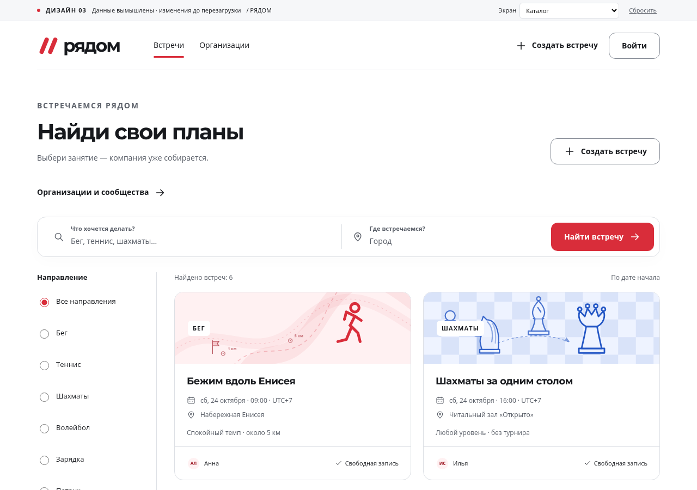

# Проверка предложений из origin/kirill

20 октября 2026, Asia/Krasnoyarsk. По поручению пользователя выполнен fetch.
`origin/main` остался на **28ab164**; найдена новая ветка `origin/kirill`,
коммит **9120106785183ddb6693e98eea2ff3f8725a0fe1**, основанный на том же main.
Правки относятся только к `design/prototype/`, а не к React-приложению.
Выборочно применены в рабочие файлы и исправлены; merge/cherry-pick/commit/push
не выполнялись. Исходный коммит сохранён в удалённой ветке после fetch.

## Решения по предложениям

| Предложение/находка | Решение и причина |
| --- | --- |
| 21 отдельная SVG-иллюстрация вместо встроенной графики | Принято, после подготовки к действующему SVG-профилю; добавлена одна сцена волейбола |
| Выбор иллюстрации на шаге 2 | Принят для HTML-макета. Выбор виден в проверке/карточке и не теряется при возврате |
| Каталог организаций | Принят как EXP-01 `#/orgs`: только допущенные, публичное описание/интересы/ссылки и число опубликованных встреч. На телефоне доступен из каталога встреч |
| Вступление в клуб, заявки, выход, счётчики членов | Не включены: это отдельная не согласованная сущность, которой нет в API/БД/задачах. В исходном макете отсутствует и полноценный путь рассмотрения заявки на членство. Режим записи встречи сохраняется отдельно |
| SCR-20 для каталога | Исправлено на EXP-01: SCR-20 уже занят модерацией направлений приложения |
| Обложка от другой категории после смены спорта | Исправлено: сохранённый выбор сбрасывается при смене направления, выбранная радиокнопка и сводка согласованы |
| Произвольное значение art из формы | Ограничено известными именами локальных файлов; некорректное имя получает штатную иллюстрацию |
| Волейбол с теннисной ракеткой | Исправлено отдельной volleyball.svg |
| Незаметные подписи 11 px, fieldset без legend, двойное имя радиокнопки | Исправлено: подписи 14 px, legend 16 px, декоративная картинка с пустым alt, стабильное доступное имя и отдельная видимая отметка выбора |
| Отложенная главная иллюстрация/нет размеров | Карточки lazy, большая обложка eager; заданы размеры 400×150 |
| Обрезанные сцены в выборе обложки | Миниатюры сохраняют пропорции 8:3 на всех четырёх проверяемых ширинах |

Все 21 исходных SVG до обработки отклонялись MEDIA-00: редакторские атрибуты,
style, text, use или clipPath не входят в закреплённый профиль. Профиль не
ослаблялся. [Подготовка набора](../../prototype/assets/event-art/README.md)
сохраняет видимые стили/геометрию и делает надписи независимыми от внешнего шрифта.
Авторский agent.md с уже неактуальными описаниями членства не импортирован;
актуальный состав описан в README ресурсов и этом отчёте.

## Проверка

- `node --check` app.js/data.js и проверки локальных переходов check_prototype.cjs:
  пройдены, включая approved-only каталог без членства, выбор/неверное имя
  обложки и сохранение при создании. Это имитация DOM.
- Общий реальный Go-валидатор MEDIA-00: **22/22 SVG**, профиль 1.0.0, до/после
  нормализации меньше 131072 байт. Новых зависимостей приложения нет.
- Проверка в Chrome: каталог, событие и организации на 320/390/768/1280 px;
  выбор иллюстрации, возврат, смена направления и локальное создание.
  Пройдена: без горизонтального переполнения, ошибок браузера и отсутствующих
  ресурсов; все 22 SVG декодируются. Просмотрены все иллюстрации и ключевые
  снимки изменённых экранов; пропорции миниатюр исправлены после визуальной проверки.
- Проверки репозитория/ссылок, handoff (48 карточек), OpenAPI и git diff --check:
  пройдены. OpenAPI/БД/React-исходники этим импортом не меняются.
- Сверка с состоянием до fetch: 39 прежних файлов сохранены побайтно, 6 общих
  документов дополнены результатами проверки; HEAD и индекс не изменены.

Полная бизнес-приёмка, загрузка фона через API и членство этим просмотром не
подтверждаются. Новый публичный listOrganizations для приложения не согласован:
EXP-01 остаётся наброском дизайна, не поручением добавлять серверный модуль.
Настоящий вход, модерация SVG и личная главная описаны текущими требованиями;
макет сохраняет прежний демовыбор и не подменяет приложение на 4180.

## Просмотр

[Дизайн-макет 0.3](http://127.0.0.1:4173/design/prototype/),
[организации](http://127.0.0.1:4173/design/prototype/#/orgs).
Статический сервер запущен отдельно на loopback 4173. Реальное приложение
и Swagger остаются на 4180. Все данные макета живут только в памяти вкладки.

Воспроизведение браузерных проверок при запущенном сервере:

```bash
PLAYWRIGHT_CHROMIUM_EXECUTABLE_PATH=/usr/bin/google-chrome node scripts/check_prototype_browser.cjs
```

Скрипт сохраняет снимки изменённых экранов/выбора и контактные листы всех
иллюстраций в `.artifacts/prototype-update/`; он не использует product API.
Предварительные правки DEC-24/25 и исправление профиля Анны сохранены отдельно
в том же незакоммиченном дереве; выборочный импорт их не заменяет.

## Снимки результата



- Организации: [1280 px](organizations-1280.png), [390 px](organizations-390.png).
- Выбор обложки: [1280 px](picker-1280.png), [390 px](picker-390.png).
- Карточка встречи: [320 px](event-320.png).
- Все 22 иллюстрации: [лист 1](art-0.png), [лист 2](art-1.png), [лист 3](art-2.png).

На полностраничных мобильных снимках нижняя навигация находится на высоте
исходного окна. При прокрутке в браузере она остаётся внизу видимой области.
