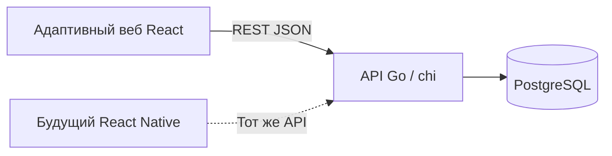

# Техническое решение Рядом

Дата: 2026-10-20. Статус: **стек и основа пакетов закреплены; бизнес-реализация не начата**.
По поручению пользователя принято [ADR-001](backend-decision.md): Go, chi,
PostgreSQL, pgx/sqlc, goose и обязательный Docker Compose. Прежний вариант
NestJS/Prisma заменён. По подготовке перед передачей принят [ADR-002](foundation-decision.md):
клиентские библиотеки/версии, пути генерации, владельцы и SVG-профиль. Основа
пакетов проверяется отдельно от ещё не реализованных бизнес-функций.

Основание — [первичные документы](../requirements/README.md),
[границы продукта](../product/scope.md) и [приёмка](../product/acceptance.md).
Статус технологий указан ниже; предметные правила описаны как предложения.
При расхождении обязательное поведение определяется первичными PDF.

## Состав проекта

| Документ | Что в нём зафиксировано |
| --- | --- |
| Этот файл | Стек, устройство приложения, модули, размещение и развитие |
| [Утверждённый бэкенд](backend-decision.md) | Выбор Go, PostgreSQL, инструментов и отказ от S3 |
| [Аватары и SVG-фоны](media.md) | Личный SVG с модерацией и готовый каталог, строки в PostgreSQL и правила показа |
| [Сброс демонабора](../product/demo-reset.md) | DEC-13: только ADMIN/деморежим, атомарный seed и завершение сессий |
| [Регистрация](../product/registration.md) | Email/пароль, имя и готовый аватар на одной странице, своя загрузка позднее в профиле; границы деморежима |
| [Вход и JWT](authentication.md) | DEC-20: email/пароль, JWT-cookie, Argon2id и серверный отзыв |
| [Блокировка аккаунта](../product/account-blocking.md) | DEC-21: ADMIN блокирует USER, контент сохраняется, все сессии отзываются |
| [Контейнеризация](../development/containerization.md) | Обязательный процесс, владельцы и условия готовности |
| [Модель данных](data-model.md) | Десять предметных таблиц и техническая demo_state, связи, ограничения, индексы и транзакции |
| [Права и состояния](access-and-states.md) | Три роли, видимость, JWT-вход и блокировка USER |
| [API 0.13.0](../contracts/api-v1.md) | Зафиксированные маршруты/DTO, права, ошибки, повторы и OpenAPI |
| [План реализации](../development/implementation-plan.md) | Этапы, зависимости, зоны владения, демоданные и проверки |
| [Карта экранов](../product/screens.md) | Маршруты, блоки страниц, состояния, навигация и адаптивность |
| [Направления и справочник](../product/activity-types.md) | DEC-07: публикация своего спорта сразу, одобрение общего списка и исправление без слияния |
| [Жалобы и восстановление](../product/reports-and-moderation.md) | DEC-08: обе цели, ручной разбор без причины, возврат сообщения на прежнее место |
| [Пользовательские пути](../product/user-flows.md) | Переходы и покрытие S1–S6/A1–A6 |

## Стек и статус решений

Сервер, хранение, способ обмена контрактами и контейнеризация утверждены в ADR-001.
React выбран пользователем ранее; клиентские библиотеки закреплены ADR-002,
зависимости установлены и проверены в BASE-01. Дополнительные продуктовые
возможности принимаются отдельными решениями; весь согласованный объём сохранён.

| Область | Выбор | Обоснование и границы |
| --- | --- | --- |
| Веб | React, TypeScript, [Vite](https://vite.dev/guide/) | Адаптивное приложение; React соответствует договорённости пользователя |
| Навигация | [React Router](https://reactrouter.com/start/declarative/installation) | Страницы каталога, встречи, профилей и кабинетов |
| Серверные данные на клиенте | [TanStack Query](https://tanstack.com/query/latest/docs/framework/react/overview) | Загрузка, кеш, инвалидирование после операций; бизнес-истина остаётся на сервере |
| Оформление | CSS Modules, токены брендбука, [Radix Primitives](https://www.radix-ui.com/primitives/docs/overview/introduction) | Сохраняем собственный дизайн; примитивы помогают с диалогами и клавиатурным взаимодействием |
| Сервер | Go 1.27, `net/http`, [chi v5](https://github.com/go-chi/chi) | Утверждено: одно приложение с предметными модулями и серверными проверками прав |
| Контракты | OpenAPI 3.0.3, [oapi-codegen](https://github.com/oapi-codegen/oapi-codegen), [openapi-typescript/openapi-fetch](https://openapi-ts.dev/openapi-fetch/) | API 0.13.0 зафиксирован; схемы/примеры и генерация для обоих языков проверены |
| Хранение | PostgreSQL 17, [pgx v5](https://pkg.go.dev/github.com/jackc/pgx/v5), [sqlc](https://docs.sqlc.dev/en/v1.31.1/guides/using-go-and-pgx.html), [goose](https://github.com/pressly/goose) | Утверждено: явные SQL-миграции, запросы, ограничения и транзакции |
| Репозиторий | [pnpm workspaces](https://pnpm.io/workspaces) для веба/TS-пакетов; отдельный модуль Go | pnpm 11.25.0 закреплён, pnpm-lock.yaml и go.mod/go.sum включены в основу |
| Тестирование | `testing`/`httptest` для API; Vitest для веба; [Playwright](https://playwright.dev/docs/intro) для сценариев | Серверные проверки на Go; веб-инструменты ещё не установлены |
| Запуск и размещение | Docker, [Docker Compose v2](https://docs.docker.com/compose/), Nginx с HTTPS в демосреде | Утверждено как обязательное условие процесса с первого этапа |
| Аватары и фоны | Личные SVG с модерацией, фоны строкой в PostgreSQL | S3 исключён; общая проверка SVG и 128 КиБ, DEC-09 |

Технические источники проверены 19 октября 2026 года; подробности — в ADR-001.
До параллельной реализации координатор проверяет совместимые версии Go,
генераторов, веб-инструментов и PostgreSQL на первом контейнерном сценарии,
затем фиксирует зависимости и образы. Рабочие пакеты и lock-файлы уже подготовлены; отдельная контейнерная
проверка не заменяет первый HTTP-контур OPS-01.
Инструменты контракта уже закреплены отдельно в
[tooling.json](../../packages/contracts/tooling.json); [проверка](../contracts/validation.md)
не заменяет первый контейнерный сценарий приложения.

## Устройство приложения

Приняты один API с предметными модулями и одна реляционная база данных.
Административный кабинет входит в веб-приложение. Проверка его прав выполняется
сервером независимо от того, какие кнопки видны в браузере.



Для будущего запуска выбран один origin: страницы по `/`, API по
`/api/v1`. Это упрощает работу браузерной сессии. Размещение остаётся проектом:
сервер у пользователя есть, он сам развернёт контейнеры. Домен и фактическая
конфигурация пока не сообщены; порядок передачи — [DEC-04](../product/decisions.md).

| Модуль API | Ответственность | Основные требования |
| --- | --- | --- |
| Accounts / Auth | Email/пароль, JWT-сессии, текущий/публичный аккаунт и блокировка USER | REQ-AUTH, DEC-20/21 |
| Organizations | Профиль, заявка на допуск, решение, публичная страница | REQ-ORG-PROFILE, REQ-ORG-APPROVAL |
| Events | Каталог, карточка, создание и публикация | REQ-EVENT, REQ-CARD, REQ-SPORT, REQ-ORG-PUBLISH |
| ActivityTypes | Список APPROVED, разрешение имени в транзакции события, административные очередь/решение/исправление | REQ-SPORT, DEC-07 |
| Reports | Одна жалоба аккаунта/цели; ручное закрытие, счётчики/фильтры; интеграция с модерацией сообщения/встречи | DEC-08 |
| Participations | Свободная запись, заявки, состав, решение автора | REQ-JOIN, REQ-PARTICIPANTS |
| Discussions | Сообщения с авторством и чтение обсуждения | REQ-DISCUSSION, REQ-OPEN-ACCESS |
| Moderation | Административный поиск, снятие события, скрытие сообщения | REQ-ADMIN-SEARCH, REQ-ADMIN-EVENT, REQ-ADMIN-MESSAGE, REQ-UNAVAILABLE |

HTTP-обработчики отвечают за транспорт, OpenAPI — за контракт данных, сервисы — за
права, переходы и транзакции, SQL-запросы — за хранение. Модуль модерации вызывает предметные операции Events,
Organizations и Discussions, а не создаёт независимую вторую реализацию правил.
Клиент не получает прямой доступ к БД и не назначает себе результат модерации.

## Предлагаемая структура

Это будущие пути, а не существующие приложения или команды запуска.

```text
apps/
  web/src/
    app/                 маршруты, провайдеры, оболочка
    features/
      auth/
      events/
      organizations/
      participation/
      discussion/
      admin/
    shared/ui/           общие веб-компоненты
  api/
    cmd/api/             точка входа Go
    internal/
      modules/           предметные модули и сервисы
      transport/         HTTP-обработчики и middleware
      generated/api/     производные OpenAPI, владелец контрактов
      generated/db/      производные sqlc, владелец БД
    db/migrations/       SQL-миграции goose
    db/queries/          исходные запросы sqlc
    db/seed/             демоданные
    test/                интеграционные проверки
packages/
  contracts/             единая спецификация OpenAPI, без SQL и секретов
  api-client/            типы и веб-клиент из OpenAPI
  design-tokens/         производные от материалов брендбука
tests/e2e/               полные сценарии браузера
infra/                   будущие Dockerfile и конфигурация proxy
compose.yaml             будущая общая контейнерная среда
docs/                    требования и проектная документация
```

Источником оформления остаётся [tokens.json](../../brandbook/assets/tokens.json).
Будущий пакет `design-tokens` должен получать значения из него; второй независимо
редактируемый набор не нужен. Контракты и клиент подробнее описаны в
[проекте API](../contracts/api-proposal.md).

## Предлагаемые упрощения первой реализации

- DEC-20: обычный вход email/пароль, JWT-cookie с проверкой sessions/ACTIVE в БД;
  подготовленные демонстрационные аккаунты входят тем же способом.
- У организации один ответственный; одна заявка на допуск, без повторной подачи.
- Для модерации выбирается снятие с публикации и скрытие отдельного сообщения.
- Информация и обсуждение опубликованных событий доступны для чтения;
  зарегистрированный пользователь может задать вопрос независимо от записи.
- Существующие записи после снятия сохраняются, дальнейшие решения по ним блокируются.
- Место задаётся текстом. Сообщения обновляются при открытии и после отправки;
  актуальность при возврате на вкладку обеспечивает повторная загрузка.

Это выбор способов реализации требований, а не дополнительные условия постановки.
Подробности и альтернативы — в [правах и состояниях](access-and-states.md).

## Размещение и воспроизводимость

Принятый комплект: `web` (Nginx со статикой и proxy), `api` (Go), `db` (PostgreSQL)
и одноразовая операция миграций. Данные БД сохраняются в постоянном томе;
демоданные загружаются явно. Обычный старт не очищает базу и не восстанавливает
исходные статусы поверх действий эксперта. Полный порядок и проверка перезапуска —
[в процессе контейнеризации](../development/containerization.md).

Будущий README должен описать зависимости, переменные окружения, запуск,
миграции, подготовку демоданных, доступы, имитации, ограничения и проверку через
сеть. Секреты задаются окружением; в репозитории будет только пример переменных.
Нужны проверка доступности API/БД и журнал ошибок с идентификатором запроса.

Исходники сейчас находятся на GitHub. Для сдачи постановка требует GitVerse:
подготовка доступной там копии остаётся отдельной задачей DELIVERY-01.
Предложение не меняет удалённые репозитории и не создаёт сервер.

## Развитие после обязательного объёма

Первыми кандидатами предлагаются фильтр «подходит новичкам» и экспорт встречи
в календарь. Их нужно отдельно выбрать, описать данные и проверить полный путь.
Фильтр не следует выводить из произвольного текста условий без явного признака.

Карты, лимиты мест, очередь, отмены, уведомления и повторения подключаются после
базовой приёмки. Нативное приложение — идея команды и не даёт дополнительных
баллов по постановке. Для React Native могут быть общими контракты, клиент API,
токены и часть утилит; веб-компоненты не считаются автоматически переносимыми.

## Что ещё нужно решить перед реализацией

- Реализовать зафиксированные в API 0.13.0 правила организаций, обсуждений и старых записей.
- Точные совместимые версии инструментов и владелец контрактов; способ генерации
  уже выбран, но ещё не проверен совместной сборкой.
- Архитектура/параметры имеющегося сервера, домен/TLS и доступ к GitVerse.
  Сервер уже есть, развёртывает пользователь по DEC-04; комплект сдачи определён PDF.
- Какие дополнительные возможности действительно войдут в первую демонстрацию.

Бэкенд и контейнеризация утверждены 19 октября 2026 года в ADR-001. Подробный
[план работ](../development/implementation-plan.md) не означает запуск разработки.
