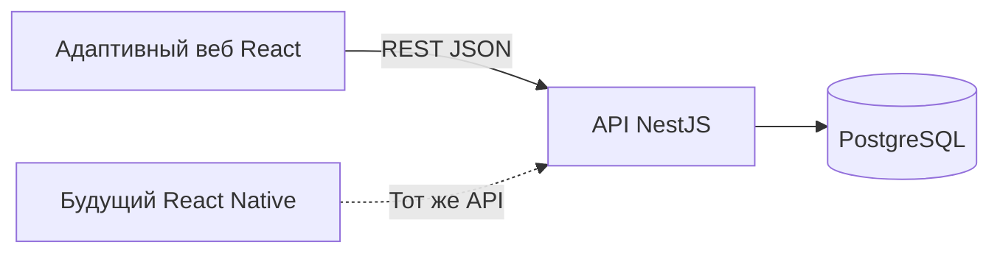

# Проект технического решения Рядом

Дата: 2026-10-19. Статус: **предложение для обсуждения, реализация не начата**.
Пользователь поручил описать решения в файлах; это не утверждение стека и не
разрешение начинать разработку, коммит или публикацию.

Основание — [первичные документы](../requirements/README.md),
[границы продукта](../product/scope.md) и [приёмка](../product/acceptance.md).
Технологии и правила ниже являются предложениями команды. При расхождении
обязательное поведение определяется первичными PDF.

## Состав проекта

| Документ | Что в нём зафиксировано |
| --- | --- |
| Этот файл | Стек, устройство приложения, модули, размещение и развитие |
| [Модель данных](data-model.md) | Восемь таблиц, связи, ограничения, индексы и транзакции |
| [Права и состояния](access-and-states.md) | Три роли, видимость данных, переходы и демовход |
| [Проект API](../contracts/api-proposal.md) | Маршруты, данные, ошибки и повторные запросы |
| [План реализации](../development/implementation-plan.md) | Этапы, зависимости, зоны владения, демоданные и проверки |
| [Карта экранов](../product/screens.md) | Маршруты, блоки страниц, состояния, навигация и адаптивность |
| [Пользовательские пути](../product/user-flows.md) | Переходы и покрытие S1–S6/A1–A6 |

## Предлагаемый стек

| Область | Выбор | Обоснование и границы |
| --- | --- | --- |
| Веб | React, TypeScript, [Vite](https://vite.dev/guide/) | Адаптивное приложение; React соответствует договорённости пользователя |
| Навигация | [React Router](https://reactrouter.com/start/declarative/installation) | Страницы каталога, встречи, профилей и кабинетов |
| Серверные данные на клиенте | [TanStack Query](https://tanstack.com/query/latest/docs/framework/react/overview) | Загрузка, кеш, инвалидирование после операций; бизнес-истина остаётся на сервере |
| Оформление | CSS Modules, токены брендбука, [Radix Primitives](https://www.radix-ui.com/primitives/docs/overview/introduction) | Сохраняем собственный дизайн; примитивы помогают с диалогами и клавиатурным взаимодействием |
| Сервер | NestJS, TypeScript, поддерживаемый Node.js LTS | Одно приложение с модулями, явными сервисами и проверками доступа |
| Контракты | [Zod](https://zod.dev/), [OpenAPI в NestJS](https://docs.nestjs.com/openapi/introduction) | Схемы запросов/ответов, проверка входа и генерируемая документация |
| Хранение | PostgreSQL, Prisma | Связанные сущности, ограничения, транзакции и [миграции](https://www.prisma.io/docs/orm/migrations/how-migrations-work) |
| Репозиторий | [pnpm workspaces](https://pnpm.io/workspaces) | Веб, API и общие пакеты с одной фиксацией зависимостей |
| Тестирование | Vitest для веба; Jest/Supertest для API; [Playwright](https://playwright.dev/docs/intro) для сценариев | Проверяем логику, права и пользовательский результат на реальной БД |
| Запуск и размещение | [Docker Compose](https://docs.docker.com/compose/), reverse proxy с HTTPS | Одинаковая конфигурация сервисов локально и на демонстрационном сервере |

Ссылки ведут к официальной документации; проверены при подготовке предложения
19 октября 2026 года. Здесь не фиксируются номера пакетов без проверки совместимости.
Перед реализацией нужно выбрать совместимые стабильные версии Node.js, React,
Vite, NestJS, Zod, Prisma и PostgreSQL, проверить генерацию OpenAPI, затем закрепить
версии, lock-файл и образы контейнеров. Сейчас зависимости не установлены.

## Устройство приложения

Предлагается один API с модулями и одна реляционная база данных.
Административный кабинет входит в веб-приложение. Проверка его прав выполняется
сервером независимо от того, какие кнопки видны в браузере.



Веб и API предлагается отдавать на одном origin: страницы по `/`, API по
`/api/v1`. Это упрощает работу браузерной сессии. Размещение остаётся проектом:
домен, сервер и конфигурация ещё не выбраны.

| Модуль API | Ответственность | Основные требования |
| --- | --- | --- |
| Accounts / Auth | Демоаккаунты, сессии, текущий пользователь, публичное имя | REQ-AUTH |
| Organizations | Профиль, заявка на допуск, решение, публичная страница | REQ-ORG-PROFILE, REQ-ORG-APPROVAL |
| Events | Направления, каталог, карточка, создание и публикация | REQ-EVENT, REQ-CARD, REQ-SPORT, REQ-ORG-PUBLISH |
| Participations | Свободная запись, заявки, состав, решение автора | REQ-JOIN, REQ-PARTICIPANTS |
| Discussions | Сообщения с авторством и чтение обсуждения | REQ-DISCUSSION, REQ-OPEN-ACCESS |
| Moderation | Административный поиск, снятие события, скрытие сообщения | REQ-ADMIN-SEARCH, REQ-ADMIN-EVENT, REQ-ADMIN-MESSAGE, REQ-UNAVAILABLE |

Контроллеры отвечают за транспорт, схемы — за форму данных, сервисы — за права,
переходы и транзакции. Модуль модерации вызывает предметные операции Events,
Organizations и Discussions, а не создаёт независимую вторую реализацию правил.
Клиент не получает прямой доступ к БД и не назначает себе результат модерации.

## Предлагаемая структура

Это будущие пути, а не существующие приложения или команды запуска.

```text
apps/
  web/src/
    app/                 маршруты, провайдеры, оболочка
    features/
      auth/
      events/
      organizations/
      participation/
      discussion/
      admin/
    shared/ui/           общие веб-компоненты
  api/
    src/modules/         предметные модули
    prisma/              будущие схема, миграции и демоданные
    test/                интеграционные проверки
packages/
  contracts/             схемы запросов и ответов, без ORM и секретов
  api-client/            генерируемый клиент из OpenAPI
  design-tokens/         производные от материалов брендбука
tests/e2e/               полные сценарии браузера
infra/                   будущие контейнеры и proxy
docs/                    требования и проектная документация
```

Источником оформления остаётся [tokens.json](../../brandbook/assets/tokens.json).
Будущий пакет `design-tokens` должен получать значения из него; второй независимо
редактируемый набор не нужен. Контракты и клиент подробнее описаны в
[проекте API](../contracts/api-proposal.md).

## Предлагаемые упрощения первой реализации

- Демовход создаёт настоящую серверную сессию; регистрация имитируется созданием
  обычного демопользователя. Имитация не распространяется на бизнес-операции.
- У организации один ответственный; одна заявка на допуск, без повторной подачи.
- Для модерации выбирается снятие с публикации и скрытие отдельного сообщения.
- Информация и обсуждение опубликованных событий доступны для чтения;
  зарегистрированный пользователь может задать вопрос независимо от записи.
- Существующие записи после снятия сохраняются, дальнейшие решения по ним блокируются.
- Место задаётся текстом. Сообщения обновляются при открытии и после отправки;
  актуальность при возврате на вкладку обеспечивает повторная загрузка.

Это выбор способов реализации требований, а не дополнительные условия постановки.
Подробности и альтернативы — в [правах и состояниях](access-and-states.md).

## Размещение и воспроизводимость

Предлагаемый комплект: статическая сборка веба, процесс API, PostgreSQL и proxy.
Данные БД сохраняются в постоянном томе. Миграции применяются отдельным шагом;
демоданные загружаются явно. Обычный старт не очищает базу и не восстанавливает
исходные статусы поверх действий эксперта.

Будущий README должен описать зависимости, переменные окружения, запуск,
миграции, подготовку демоданных, доступы, имитации, ограничения и проверку через
сеть. Секреты задаются окружением; в репозитории будет только пример переменных.
Нужны проверка доступности API/БД и журнал ошибок с идентификатором запроса.

Исходники сейчас находятся на GitHub. Для сдачи постановка требует GitVerse:
подготовка доступной там копии остаётся отдельной задачей DELIVERY-01.
Предложение не меняет удалённые репозитории и не создаёт сервер.

## Развитие после обязательного объёма

Первыми кандидатами предлагаются фильтр «подходит новичкам» и экспорт встречи
в календарь. Их нужно отдельно выбрать, описать данные и проверить полный путь.
Фильтр не следует выводить из произвольного текста условий без явного признака.

Карты, лимиты мест, очередь, отмены, уведомления и повторения подключаются после
базовой приёмки. Нативное приложение — идея команды и не даёт дополнительных
баллов по постановке. Для React Native могут быть общими контракты, клиент API,
токены и часть утилит; веб-компоненты не считаются автоматически переносимыми.

## Что ещё нужно решить перед реализацией

- Подходит ли предложенный стек навыкам команды и срокам.
- Принимаются ли упрощения по организациям, открытости обсуждений и старым записям.
- Совместимые версии пакетов, способ генерации клиента и владелец контрактов.
- Сервер для демонстрации, домен, доступ к GitVerse и точный комплект сдачи.
- Какие дополнительные возможности действительно войдут в первую демонстрацию.

Дата согласования и утверждённые решения пока отсутствуют. Подробный
[план работ](../development/implementation-plan.md) не означает их запуск.
