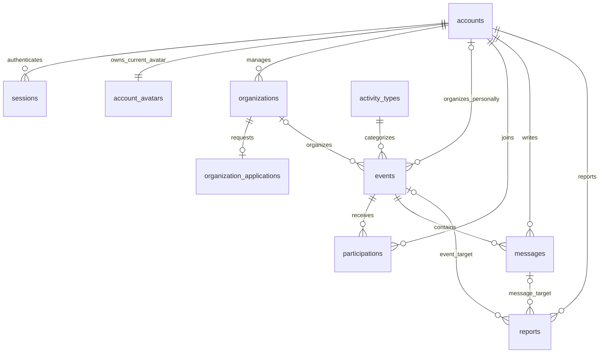

# Проект модели данных

Статус: **проект физической схемы, не реализация и не миграция**.
Транспортные DTO и поведение зафиксированы в [API 0.13.0](../contracts/api-v1.md);
названия SQL-полей не экспортируются вместо этих DTO.
Связан с [архитектурой](README.md), [правами](access-and-states.md) и
[проектом API](../contracts/api-proposal.md). Первичные PDF имеют приоритет.
Технологии хранения утверждены в [ADR-001](backend-decision.md): PostgreSQL,
pgx/sqlc и SQL-миграции goose. Это не утверждает автоматически все таблицы ниже.

## Общие правила

Предлагаются десять предметных таблиц и техническая demo_state (всего 11).
Предметные PK — UUID; singleton demo_state имеет id=1. Моменты — `timestamptz`.
Даты в API передаются в ISO 8601, в базе сравниваются как моменты времени.
Часовой пояс встречи хранится отдельно строкой IANA, например `Asia/Krasnoyarsk`.
UUID и значения по умолчанию окончательно определяются при реализации.

`NULL` в таблицах ниже означает допустимое отсутствие значения; остальные поля
обязательны. Для сущностей с изменением данных нужны `created_at` и `updated_at`;
для сессий достаточно `created_at` и `expires_at`.

У события ровно один организатор из двух возможных связей. ER-схема показывает
основные предметные связи; технические ссылки на создателя и проверяющего ниже
перечислены отдельно.

## demo_state — техническая строка деморежима

[DEC-13](../product/demo-reset.md): singleton создаётся миграцией и не удаляется
при восстановлении предметного сида. Это общий барьер транзакций и последняя
квитанция, не универсальный журнал. Нет FK на удаляемые аккаунты.

| Поле | Тип | Правило |
| --- | --- | --- |
| `id` | smallint | PK, CHECK id=1, ровно одна строка |
| `generation` | uuid | NOT NULL, новый при инициализации и каждом успешном сбросе |
| `last_reset_id` | uuid, NULL | UUID подтверждённого запроса |
| `last_reset_from_generation` | uuid, NULL | Поколение до последнего сброса |
| `last_reset_at` | timestamptz, NULL | Дата успешного сброса |
| `last_reset_seed_version` | varchar(80), NULL | Версия использованного штатного сида |
| `last_reset_base_date` | date, NULL | Дата Asia/Krasnoyarsk для относительных демовстреч |

Все last_reset-поля либо NULL до первого сброса, либо заполнены вместе.
previousGeneration не равна текущей generation. seedVersion для следующего
сброса берётся из сборки, не вводится клиентом; API сравнивает expectedSeedVersion.
Сид/квитанция/generation обновляются одним commit. При ошибке всё откатывается.
Миграция/обычный запуск/повтор seed не перезаписывают singleton и квитанцию.

Каждая транзакция бизнес-данных/сессии первым действием берёт FOR SHARE этой
строки и затем проверяет текущую авторизацию согласно режиму маршрута: публичные
чтения не требуют сессии, optional-session допускает отсутствие cookie и проверяет
предъявленную; закрытые требуют актуальных прав. Барьер защищает согласованность
чтения со сбросом, а не вводит обязательный вход для всего API. Сброс берёт FOR UPDATE первым,
после ожидания повторно проверяет ADMIN. Барьер предшествует accounts/events/
activity_types и остальным предметным блокировкам. Healthcheck/статика исключены.
Правила удаления, ожидания 5 секунд и последующего входа — в спецификации сброса.

## accounts

DEC-20/21: настоящий вход и блокировка; [полная спецификация](authentication.md).

| Поле | Тип | Правило |
| --- | --- | --- |
| id | uuid | PK |
| display_name | varchar(120) | Непустое публичное имя после trim; не уникально |
| email | varchar(254) | NOT NULL, UNIQUE; валидный ASCII email, lowercase без пробелов; не подтверждён |
| password_hash | text | NOT NULL, Argon2id PHC с отдельной солью; не публичное поле |
| system_role | enum USER / ADMIN | USER по умолчанию, клиент не назначает ADMIN |
| status | enum ACTIVE / BLOCKED | ACTIVE по умолчанию; ADMIN только ACTIVE |
| revision | integer | NOT NULL, >=1, начально 1; увеличивается только при смене status |
| blocked_at | timestamptz, NULL | Только BLOCKED, время решения |
| blocked_by_account_id | uuid, NULL | FK accounts, только BLOCKED; решивший ADMIN |
| demo_key | varchar(80), NULL | UNIQUE; стабильный ключ сида, не способ входа |
| created_at, updated_at | timestamptz | Служебные даты |

CHECK связывает status с blocked_at/blocked_by_account_id: ACTIVE — оба NULL,
BLOCKED — оба NOT NULL; system_role=ADMIN требует ACTIVE. Роль проверяющего
проверяет сервис под замком, FK один её не доказывает. Снятие блокировки очищает
оба поля. Это последнее текущее решение, не журнал; данные контента сохраняются.
Email/email-хеш/подробности блокировки не входят в публичный аккаунт: там
id/displayName/avatarUrl/isBlocked. Me дополнительно содержит только свой email.
Организация связана с ответственным аккаунтом; её допуск отделён от status.
OAuth, восстановление/смена пароля и подтверждение почты вне MVP.

## account_avatars

Одна текущая строка на аккаунт, создаётся в той же транзакции с accounts.
[DEC-09/10](../product/avatars.md): личная загрузка и готовый каталог поддерживаются
одновременно. В accounts отдельного avatar_id нет; весь текущий выбор здесь.
По [DEC-11/12](../product/registration.md) регистрация требует presetId и создаёт
PRESET/APPROVED/revision=1; отсутствие/null отклоняются. Вместе с аккаунтом
сохраняется серверная сессия. Ошибка имени/ID не оставляет частичный профиль,
аватар или новую сессию. Cookie выдаётся после commit. Новых таблиц нет.

| Поле | Тип | Правило |
| --- | --- | --- |
| `account_id` | uuid | PK и FK accounts; один аватар на человека |
| `source` | enum NONE / PRESET / CUSTOM | Изначально NONE; источник отдельно от проверки своего SVG |
| `preset_id` | varchar(64), NULL | Только PRESET, ID из общего manifest; не внешний URL и не FK в БД |
| `svg` | text, NULL | Нормализованный SVG; octet_length <= 131072, без S3/base64 |
| `status` | enum EMPTY / PENDING / APPROVED / HIDDEN | Изначально EMPTY; публично только APPROVED |
| `revision` | integer | >=0, изначально 0; +1 при загрузке, модерации и сбросе с изменением |
| `uploaded_at` | timestamptz, NULL | Последняя успешная загрузка; при модерации сохраняется |
| `reviewed_at`, `reviewed_by` | timestamptz / uuid, NULL | Последнее решение ADMIN, FK accounts; у EMPTY/PENDING NULL |
| `created_at`, `updated_at` | timestamptz | Создание строки и фактическое изменение; безопасный повтор не меняет |

CHECK по источнику и состоянию:

- NONE требует EMPTY и preset_id/svg/uploaded_at/reviewed_at/reviewed_by NULL.
- PRESET требует APPROVED, preset_id и revision>=1; svg/uploaded_at/reviewed_at/
  reviewed_by NULL. Готовый вариант проверен при подготовке сборки, нового решения
  ADMIN нет. Принадлежность ID manifest проверяет сервис при выборе.
- CUSTOM требует preset_id=NULL, непустые svg/uploaded_at и revision>=1. PENDING
  имеет reviewed_at/by NULL; APPROVED/HIDDEN — оба поля заполнены. EMPTY недопустим.

Общий allowlist XML проверяет сервис, SQL проверяет итоговый размер личного SVG.
Клиент не назначает source/status/reviewer. preset_id следует тому же формату ID,
что в OpenAPI. Отдельная таблица/FK для статического каталога не создаётся.

Загрузка заменяет любой текущий источник без архива прежнего, всегда делает
CUSTOM/PENDING и очищает preset_id. Выбор готового делает PRESET/APPROVED,
очищает SVG/даты загрузки/решения. Сброс делает NONE/EMPTY, очищает оба вида выбора,
сохраняет строку и увеличенную revision;
повторная загрузка не начинает версию с нуля. Это защита от старых форм решений.
Публичный avatarUrl формируется на чтении: CUSTOM/APPROVED — API URL с revision;
PRESET — статический URL только существующего ID из manifest. Если ID исключён
из сборки, в БД он сохраняется, но avatarUrl/previewUrl=null, публично заглушка.
Смена manifest не меняет revision аккаунта. URL не хранится в accounts и не
является произвольной ссылкой пользователя.

Индексы (status, uploaded_at, account_id) для очереди и поиск по display_name
через accounts; индекс очереди частичный WHERE source='CUSTOM'. NONE/PRESET
не перечисляются в adminListAvatars и дают 404 прямых административных операций.
Готовые SVG поставляются с вебом из общего manifest, без новых таблиц и S3.

## sessions

| Поле | Тип | Правило |
| --- | --- | --- |
| id | uuid | PK, случайный UUID для jti JWT, не переиспользуется |
| account_id | uuid | FK accounts, равен sub JWT |
| token_hash | text | UNIQUE, SHA-256 полного JWT; исходный JWT не хранится |
| created_at, expires_at | timestamptz | Согласованы с iat/exp; expires_at=created_at+24 часа |

Проверяются подпись/claims и существование строки с теми же ID, account_id,
token_hash и сроком; аккаунт должен быть ACTIVE. Права берутся из БД. Logout
удаляет текущую сессию, блокировка — все сессии цели одним commit со status.
Разблокировка их не возвращает. Reset удаляет все sessions. Refresh-токена нет.

До предметных замков защищённая операция берёт общий барьер DEC-13, затем
accounts актёра FOR SHARE до конца транзакции и проверяет актуальные статус/сессию.
ADMIN-блокировка после своего FOR SHARE проверяет неизменяемую роль цели и берёт
FOR UPDATE только с условием system_role=USER. ADMIN отвергается до эксклюзивного
замка, иначе возможна перекрёстная блокировка. Общие правила задаются уже в BE-02,
а не добавляются независимо поздними задачами. Полный порядок — [вход](authentication.md).

## organizations

| Поле | Тип | Правило |
| --- | --- | --- |
| `id` | uuid | PK |
| `owner_account_id` | uuid | FK accounts; один ответственный у профиля |
| `name` | varchar(160) | Непустое название |
| `description` | text | Описание деятельности |
| `sport_interests` | text | Спортивные интересы, непустая строка |
| `created_at`, `updated_at` | timestamptz | Служебные даты |

Один аккаунт может владеть несколькими профилями; это не требует нескольких
управляющих у одной организации. Публичность определяется одобрением заявки.
В этой таблице нет копии статуса допуска: единственный источник — заявка.

## organization_applications

| Поле | Тип | Правило |
| --- | --- | --- |
| `id` | uuid | PK |
| `organization_id` | uuid | FK organizations, UNIQUE |
| `status` | enum PENDING / APPROVED / REJECTED | При подаче PENDING |
| `reviewed_by` | uuid, NULL | FK accounts, администратор решения |
| `reviewed_at` | timestamptz, NULL | Момент решения |
| `rejection_reason` | text, NULL | Непустая причина обязательна при REJECTED |
| `created_at`, `updated_at` | timestamptz | Служебные даты |

Отсутствие заявки означает «не отправлена», а не отказ. Для PENDING поля решения
пусты. Для APPROVED/REJECTED проверяющий и дата обязательны. При APPROVED причина
отказа пуста. Одна заявка на профиль — предлагаемое упрощение; повторная подача
потребует отдельного решения о раундах рассмотрения и изменения UNIQUE.

## activity_types

| Поле | Тип | Правило |
| --- | --- | --- |
| `id` | uuid | PK |
| `name` | varchar(100) | Отображаемое непустое название |
| `normalized_name` | text | UNIQUE |
| `is_seeded` | boolean | Входит ли направление в подготовленный список |
| `catalog_status` | enum PENDING / APPROVED / REJECTED | Включение в общий справочник; использование во встречах разрешено при любом значении |
| `created_by_account_id` | uuid, NULL | FK accounts; фактический создатель, NULL только для seed |
| `reviewed_by_account_id` | uuid, NULL | FK accounts; администратор решения |
| `reviewed_at` | timestamptz, NULL | Дата решения |
| `rejection_reason` | text, NULL | Непустая причина только для REJECTED, максимум 2000 символов |
| `created_at`, `updated_at` | timestamptz | Служебные даты |

Нормализация: Unicode NFC, удаление пробелов по краям, свёртка повторных пробелов,
приведение регистра по единому алгоритму на сервере. Это не поиск синонимов:
«бег» и «бег трусцой» могут оставаться разными направлениями.
При создании события принимается существующий ID либо собственное название.
Новое направление и событие сохраняются в одной транзакции. Конкурентное создание
одинакового нормализованного названия разрешается через UNIQUE и повторное чтение.

По [DEC-07](../product/activity-types.md) seed создаётся APPROVED, новое имя —
PENDING. Совпавшее существующее имя/ID любого состояния используется повторно,
не меняя решения. Общий список выбора возвращает только APPROVED, но поиск
событий и фильтр по направлению не ограничены этим состоянием.

Условия целостности:

- seed: APPROVED, создатель/проверяющий/дата проверки/причина NULL;
- пользовательское направление всегда имеет создателя;
- PENDING: проверяющий/дата/причина NULL;
- пользовательское APPROVED: проверяющий и дата заполнены, причина NULL;
- REJECTED: проверяющий, дата и непустая причина заполнены.

Первое решение PENDING → APPROVED/REJECTED сохраняется под блокировкой. Повтор
не переписывает проверяющего и дату. Имя можно исправить в любом состоянии,
включая seed, без изменения решения. name/normalized_name меняются вместе;
expectedName защищает от перезаписи устаревшей формы.
При коллизии с другим ID исправление/одобрение целиком откатывается.

ID сохраняется: события продолжают ссылаться на ту же строку и при чтении
показывают новое имя. Обновлять FK всех событий не требуется. Уникальность имени
общая для seed и всех состояний. Алиасов, слияния, удаления и отдельной таблицы
заявок направлений нет. Прежнее написание после исправления не резервируется.

## events

| Поле | Тип | Правило |
| --- | --- | --- |
| `id` | uuid | PK |
| `created_by_account_id` | uuid | FK accounts, фактический создатель |
| `organizer_account_id` | uuid, NULL | FK accounts, личный организатор |
| `organization_id` | uuid, NULL | FK organizations, организатор-организация |
| `activity_type_id` | uuid | FK activity_types |
| `title` | varchar(160) | Непустое название |
| `description` | text | Непустое описание |
| `starts_at` | timestamptz | Момент начала |
| `timezone` | varchar(80) | Проверенный идентификатор IANA |
| `city` | varchar(120) | Город для отображения и простого фильтра |
| `location_text` | text | Понятный адрес или описание места |
| `conditions` | text | Условия участия; допускается пустая строка при отсутствии требований |
| `cover_svg` | text, NULL | MEDIA-01: проверенный нормализованный SVG, максимум 131 072 байт включительно; NULL — штатный фон |
| `join_mode` | enum OPEN / APPROVAL | Способ записи |
| `publication_status` | enum PUBLISHED / UNPUBLISHED | В базовом проекте нет черновиков |
| `unpublished_by` | uuid, NULL | FK accounts, администратор |
| `unpublished_at` | timestamptz, NULL | Момент снятия |
| `unpublish_reason` | text, NULL | Непустая причина для организатора |
| `reports_revision` | integer | DEC-08: >= 0, изначально 0; версия только прямых жалоб на встречу, в API eventReportsRevision |
| `created_at`, `updated_at` | timestamptz | Служебные даты |

CHECK: ровно одно из `organizer_account_id` и `organization_id` заполнено.
Для личной встречи создатель совпадает с организатором; для организации сервис
проверяет владение и APPROVED у заявки. Клиент не задаёт служебные поля.
Для UNPUBLISHED обязательны все три поля снятия; для PUBLISHED они пусты.
Условия, город и ограничения длины — предложения представления данных, не новый
обязательный набор полей постановки. При отсутствии условий интерфейс пишет
«Дополнительных требований нет».

`account_avatars` и `cover_svg` — дополнение по решению пользователя об оформлении,
не требования официальной постановки. Правила валидации и выдачи —
[в предложении по медиа](media.md). Списки событий не возвращают строку SVG;
загрузка/сброс фона не меняют статусы допуска, публикации или участия.
Размер утверждён отдельно: база в UTF-8 должна иметь ограничение
`CHECK (cover_svg IS NULL OR octet_length(cover_svg) <= 131072)`.
Оно дополняет проверку исходной строки сервером и не заменяет проверку SVG.

Выбор календарного дня каталога по DEC-19 использует поля самой встречи,
без новой таблицы или копии даты: `(events.starts_at AT TIME ZONE events.timezone)::date`
сравнивается с dateFrom (включительно) и dateTo (исключительно). При наличии from/to
все условия объединяются AND перед ORDER BY/LIMIT. Одна пара границ UTC для всех
зон не заменяет это условие. Фильтры включаются в курсор; план запроса проверяется
при реализации BE-03 на PostgreSQL.

## participations

| Поле | Тип | Правило |
| --- | --- | --- |
| `id` | uuid | PK |
| `event_id` | uuid | FK events |
| `account_id` | uuid | FK accounts, участник |
| `status` | enum PENDING / CONFIRMED / REJECTED | Результат участия |
| `decided_by` | uuid, NULL | FK accounts, автор решения по заявке |
| `decided_at` | timestamptz, NULL | Момент решения по заявке |
| `created_at`, `updated_at` | timestamptz | Служебные даты |

UNIQUE (`event_id`, `account_id`). OPEN создаёт CONFIRMED без проверяющего;
APPROVAL создаёт PENDING. Принятие/отказ заполняют `decided_by` и `decided_at`.
Эта пара либо заполнена целиком, либо пуста. REJECTED требует решения; CONFIRMED
может быть как свободной записью, так и принятой заявкой.
Сервер не позволяет клиенту подменить статус. Повторная запись после отказа,
отзыв и отмена не входят в базовый проект.

### Личные планы по DEC-14

Для главной JOIN participations → events использует существующие status,
starts_at, timezone и publication_status. Дублировать время начала в participations
или добавлять признак «завершена/посетил» не нужно. Оба режима включают только
свои записи CONFIRMED на PUBLISHED; параметры API позволяют отдельно фильтровать
другие статусы, но главная их за участие не выдаёт.

- UPCOMING: `events.starts_at > referenceTime`.
- STARTED_TODAY: `events.starts_at <= referenceTime` и
  `(events.starts_at AT TIME ZONE events.timezone)::date =
  (referenceTime AT TIME ZONE events.timezone)::date`.
- STARTED (DEC-15): `events.starts_at <= referenceTime`, все дни, только PUBLISHED;
  `events.starts_at DESC, events.id DESC` до LIMIT. Это отдельный режим полного
  личного списка. «Все записи» без окна сохраняет ограниченные UNPUBLISHED.
- Фильтрация перед LIMIT; UPCOMING/STARTED_TODAY упорядочены по
  `events.starts_at ASC, events.id ASC`. UNIQUE пары событие/аккаунт делает
  этот ключ однозначным для личной выдачи.
- referenceTime задаётся сервером при первом чтении либо берётся из явного
  параметра/курсора; не хранится в предметных таблицах. Оба блока используют
  один момент. Это граница чтения, не снимок БД и не замена актуального now
  при joinEvent/decideParticipation.
- Без eventWindow сохраняются все даты/публикации и порядок
  `participations.created_at DESC, participations.id DESC`. UNPUBLISHED
  отдаётся ограниченной сводкой по прежним правам.

Новых таблиц или миграций данных это решение не требует; правила —
[DEC-14](../product/decisions.md), параметры/курсор —
[контракт API](../contracts/api-v1.md#личные-временные-выборки-dec-14).

## messages

| Поле | Тип | Правило |
| --- | --- | --- |
| `id` | uuid | PK |
| `event_id` | uuid | FK events |
| `author_account_id` | uuid | FK accounts |
| `body` | text | Непустое сообщение |
| `status` | enum VISIBLE / HIDDEN | Изначально VISIBLE |
| `hidden_by` | uuid, NULL | FK accounts, администратор |
| `hidden_at` | timestamptz, NULL | Последнее скрытие; сохраняется после восстановления |
| `restored_by` | uuid, NULL | FK accounts, администратор последнего восстановления |
| `restored_at` | timestamptz, NULL | Последнее восстановление; сохраняется после нового скрытия |
| `moderation_revision` | integer | >= 0, изначально 0; +1 при фактическом изменении VISIBLE/HIDDEN |
| `reports_revision` | integer | >= 0, изначально 0; версия жалоб этого сообщения |
| `created_at`, `updated_at` | timestamptz | Служебные даты |

Для HIDDEN нужны `hidden_by` и `hidden_at`. Каждая пара hidden/restored целиком
NULL или целиком заполнена. Изначально VISIBLE имеет все эти поля NULL;
после восстановления VISIBLE сохраняет сведения о последнем скрытии и восстановлении.
Текущее состояние определяется status и moderation_revision, не порядком дат.
Ответ организатора — обычное сообщение с различимым автором. Отдельная таблица
чатов не нужна: одно обсуждение относится к одному событию. Текст скрытого
сообщения не передаётся обычным пользователям, включая его автора.

## reports

DEC-08: [жалобы на встречи и сообщения](../product/reports-and-moderation.md).
Это отдельная сущность, не состояние публикации, организации или участия.

| Поле | Тип | Правило |
| --- | --- | --- |
| `id` | uuid | PK |
| `reporter_account_id` | uuid | FK accounts; только из сессии |
| `target_type` | enum EVENT / MESSAGE | Ровно один тип цели |
| `target_event_id` | uuid, NULL | FK events; заполнен только для EVENT |
| `target_message_id` | uuid, NULL | FK messages; заполнен только для MESSAGE |
| `status` | enum OPEN / RESOLVED / DISMISSED | Изначально OPEN; закрытие окончательно |
| `created_at` | timestamptz | Первая подача |
| `updated_at` | timestamptz | Первая подача или фактическое закрытие; повтор не меняет |
| `reviewed_at` | timestamptz, NULL | Дата ручного решения |
| `reviewed_by` | uuid, NULL | FK accounts, ADMIN |

CHECK: EVENT означает непустой target_event_id и NULL target_message_id;
MESSAGE — наоборот. Обе ссылки настоящие FK, а не непроверяемый target_id.
OPEN имеет reviewed_at/by NULL; для закрытых оба обязательны. Причины/категории/
текста жалобы нет. Закрытые записи сохраняются и повторно не открываются.
Удаления целей в MVP нет; FK не должен каскадно уничтожать историю жалоб.

Два частичных UNIQUE: (reporter_account_id, target_event_id) WHERE target_event_id
IS NOT NULL и аналогичный для target_message_id. Они обеспечивают один отчёт
на аккаунт/цель за всё время, включая закрытый. Повтор не меняет created_at,
reviewed_at/by, статус и версию. Проверки авторства/публикации выполняет сервис.

Индексы для OPEN по target_event_id и target_message_id с created_at/id;
messages(event_id, id) связывает жалобы сообщений со встречей. Административные
счётчики вычисляются по OPEN без размножения строк при JOIN; счётчик сообщений
не включается в прямой счётчик встречи. hasOpenReports фильтруется до пагинации.
Число жалоб не запускает автоматическое скрытие.

## Ограничения и индексы

FK предлагается создавать с RESTRICT для удаления предметных данных; физическое
удаление событий и аккаунтов в базовой версии отсутствует. Сессии можно удалять
отдельно. Модерация сохраняет связи событий, записей и сообщений.

| Индекс | Для чего |
| --- | --- |
| UNIQUE accounts(email) | Повторный вход и запрет дублей канонического адреса |
| accounts(status, created_at, id) | Фильтр/порядок административного списка |
| UNIQUE sessions(token_hash) | Проверка предъявленного JWT |
| sessions(account_id), sessions(expires_at) | Выход и очистка истёкших сессий |
| organizations(owner_account_id) | Кабинет ответственного |
| UNIQUE organization_applications(organization_id) | Одна заявка на профиль |
| organization_applications(status, created_at, id) | Очередь администратора |
| UNIQUE activity_types(normalized_name) | Свой вид спорта без дублей нормализованного имени |
| activity_types(catalog_status, created_at, id) | Очередь проверки направлений |
| events(publication_status, starts_at, id) | Каталог |
| events(activity_type_id, publication_status, starts_at, id) | Фильтр направления |
| events(organizer_account_id), events(organization_id) | События автора и организации |
| UNIQUE participations(event_id, account_id) | Запрет дублей участия |
| participations(event_id, status, created_at, id), participations(account_id) | Заявки автора и мои записи |
| participations(account_id, status, event_id) | Кандидаты личных планов DEC-14 перед JOIN с events; не заменяет сортировку результата |
| messages(event_id, created_at, id) | Обсуждение в порядке сообщений |

Для малого демонабора поиск по названию/городу можно выполнять обычным SQL.
Полнотекстовые индексы, геопоиск и отдельный поисковый сервис выбираются после
появления измеримой необходимости. Индексы технических FK проверяются при миграции;
список выше не заменяет анализ запросов.

## Транзакции и одновременные действия

Предложение опирается на [блокировки PostgreSQL](https://www.postgresql.org/docs/current/explicit-locking.html)
и [транзакции pgx](https://pkg.go.dev/github.com/jackc/pgx/v5#Conn.BeginTx).
Операции sqlc выполняются на одной транзакции pgx; порядок блокировок задаётся
явно. Ограничения определяются SQL-миграциями, блокировки — SQL-запросами;
типизированная генерация не заменяет проверку конкурентных действий.

1. Создание события организации: заблокировать строку организации, проверить
   владельца и одобрение; сохранить направление и опубликованное событие атомарно.
2. Решение о допуске: блокировать организацию, затем заявку; изменить только
   PENDING. Сохранять решение, проверяющего, время и причину одним действием.
3. Запись: блокировать событие, проверить PUBLISHED и право действия; затем
   получить актуальное серверное время и потребовать now < starts_at. Вернуть
   существующее участие или создать нужное состояние. Не делать «проверка, затем
   вставка» без UNIQUE и обработки конкуренции.
4. Решение по участнику: блокировать событие, затем запись; проверить автора,
   публикацию и актуальное now < starts_at после ожидания блокировок. Затем
   проверить состояние участия. Повтор того же решения возвращает сохранённый результат,
   противоположное решение конфликтует.
5. Снятие: блокировать то же событие, атомарно изменить статус и поля причины.
   Оно сериализуется с записью и решениями. Если запись завершилась раньше,
   она сохраняется; если снятие раньше — новая запись не проходит.
6. Новое сообщение: блокировать событие и проверить публикацию/сессию перед
   вставкой. Скрытие/восстановление: событие, затем сообщение. Нужное состояние
   уже установлено — безопасный повтор; иначе expectedRevision совпадает с
   moderation_revision, или MESSAGE_CHANGED. Переход увеличивает версию;
   скрытие атомарно закрывает OPEN-жалобы только этого сообщения как RESOLVED.
7. Решение/переименование направления: блокировать activity_types, проверить
   терминальный повтор либо expectedName, проверить свободное normalized_name.
   Исправление и одобрение атомарны. Конфликт UNIQUE при переименовании даёт
   ACTIVITY_TYPE_NAME_CONFLICT, а при создании события означает повторное
   разрешение существующего направления. Публикации и участия не обновляются.

Общий порядок для операций над существующим событием: событие → участие или
сообщение. Повторные попытки при конфликте/взаимной блокировке ограничены;
внешние запросы внутри транзакции не выполняются. Точная реализация проверяется
интеграционными тестами с настоящим PostgreSQL.

Временная граница записи/решений утверждена в [DEC-01](../product/decisions.md):
равенство starts_at уже закрывает операции. Время начала транзакции не подходит
для запроса, который ждал блокировки; нужна актуальная отметка непосредственно
перед операцией. Проверка начала выполняется до возврата повтора и не меняет
статусы события или старых участий. Начало не требует отдельной миграции статусов,
cron-задачи или автоматического отклонения PENDING. Прочие операции не получают
новый запрет по времени начала.

### Жалобы и решения DEC-08

Новая жалоба блокирует событие, для MESSAGE затем сообщение, проверяет доступ,
публикацию/авторство, существующий дубль и доступность новой цели. Под этим же
порядком блокировок INSERT и увеличение reports_revision цели атомарны.
Конкурентный UNIQUE не даёт дубля; возвращается сохранённая запись. Начало
встречи не запрещает жалобу. Прямые жалобы на встречу и жалобы на сообщения
имеют независимые версии. Отдельного триггера автоматического скрытия нет.

Снятие встречи в той же транзакции закрывает только её прямые OPEN-жалобы как
RESOLVED. Жалобы на сообщения сохраняются для отдельного разбора. Скрытие
сообщения закрывает только его OPEN. Закрытие непустой группы увеличивает
reports_revision своей цели на один; у жалоб записываются reviewed_at/by ADMIN.
Восстановление не открывает закрытые жалобы и не восстанавливает публикацию.

Отклонение жалоб берёт тот же порядок блокировок event → message (если нужен)
→ reports. Нет OPEN — 200 без изменений; иначе expectedReportsRevision должен
совпасть, или REPORTS_CHANGED. Только OPEN переходят в DISMISSED, версия +1.
Повтор не переписывает закрытые записи и не захватывает новую пачку жалоб.
Другой порядок блокировок и разноцелевые массовые операции не вводятся.
После ожидания блокировки перечитываются текущие версии/состояния. Требуются
проверки параллельных подач/решений на PostgreSQL при реализации BE-11.

### Готовый и личный SVG-аватар DEC-09/10

Все изменения блокируют accounts → account_avatars. После ожидания читается
актуальная revision; сравнение/переход/сохранение SVG и дат атомарны. Загрузка
уже имеющегося PENDING с тем же нормализованным SVG возвращает его без изменений;
иначе требует expectedRevision=current. Новая загрузка CUSTOM/PENDING увеличивает
версию, очищает preset_id/решение. Ошибка XML/размера не изменяет существующую строку.

Выбор готового сначала проверяет ID в manifest текущей сборки. Неизвестный ID —
422 без изменения строки. Уже PRESET с тем же ID — безопасный повтор без изменений;
иначе expectedRevision обязан совпасть. Смена на PRESET/APPROVED, очистка личного
SVG/дат и revision+1 атомарны. Это удаляет прежнюю загрузку из текущей очереди.
Новая загрузка после PRESET снова требует модерации; автоматического возврата нет.

Сброс уже EMPTY — повтор без изменений; иначе требует совпадения версии и
увеличивает её при очистке. Модерация NONE/PRESET даёт 404; переход CUSTOM требует совпадения
версии и увеличивает её. У уже нужного статуса повтор 200 разрешён только при
expectedRevision=current либо current-1; прочее AVATAR_CHANGED. Так старое решение
не применится к новому файлу или более позднему обратному переходу.

Личное изображение читается с совпадающей revision; публичное — только CUSTOM/APPROVED,
приватное — после проверки владельца/ADMIN. Изменение между DTO и запросом картинки
даёт 404, а не SVG другой версии. Требуются PostgreSQL-тесты upload/review/reset
и повторов при MEDIA-01A. Физический архив файлов и универсальный аудит отложены.

## Границы этой схемы

Здесь нет универсального журнала аудита, файловой библиотеки, подписок, нескольких управляющих,
лимитов мест, очереди и восстановления публикации. Причины обязательных решений
сохраняются в предметных таблицах. Добавление этих возможностей потребует новой
версии проекта схемы, миграции и проверки зависимых контрактов.
SVG-фон предложен отдельным полем события, а не универсальным хранилищем файлов.
