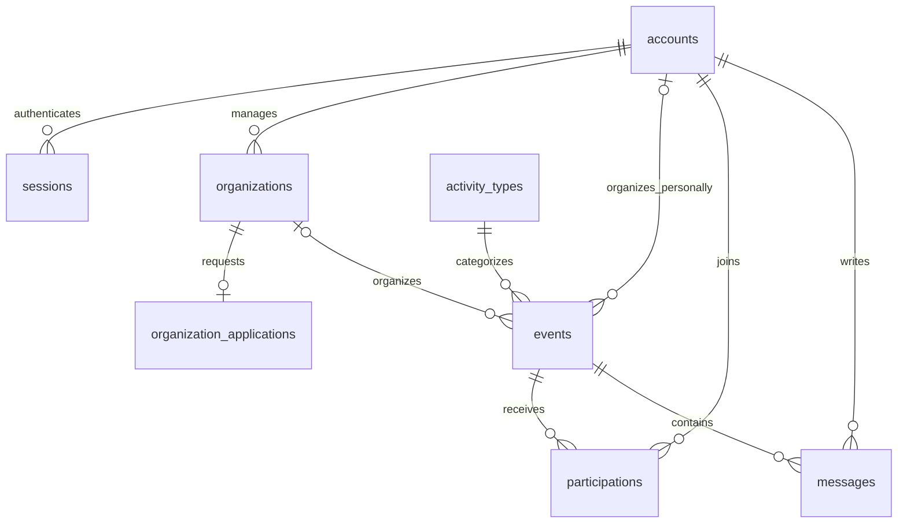

# Проект модели данных

Статус: **предложение, не реализованная схема и не миграция**.
Связан с [архитектурой](README.md), [правами](access-and-states.md) и
[проектом API](../contracts/api-proposal.md). Первичные PDF имеют приоритет.

## Общие правила

Предлагаются восемь таблиц. Все PK — UUID; моменты времени — `timestamptz`.
Даты в API передаются в ISO 8601, в базе сравниваются как моменты времени.
Часовой пояс встречи хранится отдельно строкой IANA, например `Asia/Krasnoyarsk`.
UUID и значения по умолчанию окончательно определяются при реализации.

`NULL` в таблицах ниже означает допустимое отсутствие значения; остальные поля
обязательны. Для сущностей с изменением данных нужны `created_at` и `updated_at`;
для сессий достаточно `created_at` и `expires_at`.

У события ровно один организатор из двух возможных связей. ER-схема показывает
основные предметные связи; технические ссылки на создателя и проверяющего ниже
перечислены отдельно.

## accounts

| Поле | Тип | Правило |
| --- | --- | --- |
| `id` | uuid | PK |
| `display_name` | varchar(120) | Непустое публичное имя |
| `system_role` | enum USER / ADMIN | По умолчанию USER, клиент не назначает ADMIN |
| `demo_key` | varchar(80), NULL | UNIQUE, идентификатор подготовленного демопрофиля |
| `created_at`, `updated_at` | timestamptz | Служебные даты |

Организация представлена профилем и связанным ответственным аккаунтом. Таким
образом, USER/ADMIN — технические полномочия аккаунта, а организация — третий
продуктовый контекст через владение профилем. Отдельная роль «организатор» не нужна.
Пароли, email и OAuth не входят в предлагаемую демоверсию. Их можно добавить
при проектировании настоящей авторизации.

## sessions

| Поле | Тип | Правило |
| --- | --- | --- |
| `id` | uuid | PK |
| `account_id` | uuid | FK accounts |
| `token_hash` | text | UNIQUE; исходный случайный токен в БД не сохраняется |
| `created_at`, `expires_at` | timestamptz | `expires_at > created_at` |

Права вычисляются по аккаунту и связям, а не хранятся клиентом в cookie.
Выход удаляет сессию; истёкшая сессия не авторизует запрос.

## organizations

| Поле | Тип | Правило |
| --- | --- | --- |
| `id` | uuid | PK |
| `owner_account_id` | uuid | FK accounts; один ответственный у профиля |
| `name` | varchar(160) | Непустое название |
| `description` | text | Описание деятельности |
| `sport_interests` | text | Спортивные интересы, непустая строка |
| `created_at`, `updated_at` | timestamptz | Служебные даты |

Один аккаунт может владеть несколькими профилями; это не требует нескольких
управляющих у одной организации. Публичность определяется одобрением заявки.
В этой таблице нет копии статуса допуска: единственный источник — заявка.

## organization_applications

| Поле | Тип | Правило |
| --- | --- | --- |
| `id` | uuid | PK |
| `organization_id` | uuid | FK organizations, UNIQUE |
| `status` | enum PENDING / APPROVED / REJECTED | При подаче PENDING |
| `reviewed_by` | uuid, NULL | FK accounts, администратор решения |
| `reviewed_at` | timestamptz, NULL | Момент решения |
| `rejection_reason` | text, NULL | Непустая причина обязательна при REJECTED |
| `created_at`, `updated_at` | timestamptz | Служебные даты |

Отсутствие заявки означает «не отправлена», а не отказ. Для PENDING поля решения
пусты. Для APPROVED/REJECTED проверяющий и дата обязательны. При APPROVED причина
отказа пуста. Одна заявка на профиль — предлагаемое упрощение; повторная подача
потребует отдельного решения о раундах рассмотрения и изменения UNIQUE.

## activity_types

| Поле | Тип | Правило |
| --- | --- | --- |
| `id` | uuid | PK |
| `name` | varchar(100) | Отображаемое непустое название |
| `normalized_name` | text | UNIQUE |
| `is_seeded` | boolean | Входит ли направление в подготовленный список |
| `created_at`, `updated_at` | timestamptz | Служебные даты |

Нормализация: Unicode NFC, удаление пробелов по краям, свёртка повторных пробелов,
приведение регистра по единому алгоритму на сервере. Это не поиск синонимов:
«бег» и «бег трусцой» могут оставаться разными направлениями.
При создании события принимается существующий ID либо собственное название.
Новое направление и событие сохраняются в одной транзакции. Конкурентное создание
одинакового нормализованного названия разрешается через UNIQUE и повторное чтение.

## events

| Поле | Тип | Правило |
| --- | --- | --- |
| `id` | uuid | PK |
| `created_by_account_id` | uuid | FK accounts, фактический создатель |
| `organizer_account_id` | uuid, NULL | FK accounts, личный организатор |
| `organization_id` | uuid, NULL | FK organizations, организатор-организация |
| `activity_type_id` | uuid | FK activity_types |
| `title` | varchar(160) | Непустое название |
| `description` | text | Непустое описание |
| `starts_at` | timestamptz | Момент начала |
| `timezone` | varchar(80) | Проверенный идентификатор IANA |
| `city` | varchar(120) | Город для отображения и простого фильтра |
| `location_text` | text | Понятный адрес или описание места |
| `conditions` | text | Условия участия; допускается пустая строка при отсутствии требований |
| `join_mode` | enum OPEN / APPROVAL | Способ записи |
| `publication_status` | enum PUBLISHED / UNPUBLISHED | В базовом проекте нет черновиков |
| `unpublished_by` | uuid, NULL | FK accounts, администратор |
| `unpublished_at` | timestamptz, NULL | Момент снятия |
| `unpublish_reason` | text, NULL | Непустая причина для организатора |
| `created_at`, `updated_at` | timestamptz | Служебные даты |

CHECK: ровно одно из `organizer_account_id` и `organization_id` заполнено.
Для личной встречи создатель совпадает с организатором; для организации сервис
проверяет владение и APPROVED у заявки. Клиент не задаёт служебные поля.
Для UNPUBLISHED обязательны все три поля снятия; для PUBLISHED они пусты.
Условия, город и ограничения длины — предложения представления данных, не новый
обязательный набор полей постановки. При отсутствии условий интерфейс пишет
«Дополнительных требований нет».

## participations

| Поле | Тип | Правило |
| --- | --- | --- |
| `id` | uuid | PK |
| `event_id` | uuid | FK events |
| `account_id` | uuid | FK accounts, участник |
| `status` | enum PENDING / CONFIRMED / REJECTED | Результат участия |
| `decided_by` | uuid, NULL | FK accounts, автор решения по заявке |
| `decided_at` | timestamptz, NULL | Момент решения по заявке |
| `created_at`, `updated_at` | timestamptz | Служебные даты |

UNIQUE (`event_id`, `account_id`). OPEN создаёт CONFIRMED без проверяющего;
APPROVAL создаёт PENDING. Принятие/отказ заполняют `decided_by` и `decided_at`.
Эта пара либо заполнена целиком, либо пуста. REJECTED требует решения; CONFIRMED
может быть как свободной записью, так и принятой заявкой.
Сервер не позволяет клиенту подменить статус. Повторная запись после отказа,
отзыв и отмена не входят в базовый проект.

## messages

| Поле | Тип | Правило |
| --- | --- | --- |
| `id` | uuid | PK |
| `event_id` | uuid | FK events |
| `author_account_id` | uuid | FK accounts |
| `body` | text | Непустое сообщение |
| `status` | enum VISIBLE / HIDDEN | Изначально VISIBLE |
| `hidden_by` | uuid, NULL | FK accounts, администратор |
| `hidden_at` | timestamptz, NULL | Момент скрытия |
| `created_at`, `updated_at` | timestamptz | Служебные даты |

Для HIDDEN нужны `hidden_by` и `hidden_at`; для VISIBLE они пусты.
Ответ организатора — обычное сообщение с различимым автором. Отдельная таблица
чатов не нужна: одно обсуждение относится к одному событию. Текст скрытого
сообщения не передаётся обычным пользователям, включая его автора.

## Ограничения и индексы

FK предлагается создавать с RESTRICT для удаления предметных данных; физическое
удаление событий и аккаунтов в базовой версии отсутствует. Сессии можно удалять
отдельно. Модерация сохраняет связи событий, записей и сообщений.

| Индекс | Для чего |
| --- | --- |
| UNIQUE sessions(token_hash) | Поиск сессии |
| sessions(account_id), sessions(expires_at) | Выход и очистка истёкших сессий |
| organizations(owner_account_id) | Кабинет ответственного |
| UNIQUE organization_applications(organization_id) | Одна заявка на профиль |
| organization_applications(status, created_at, id) | Очередь администратора |
| UNIQUE activity_types(normalized_name) | Свой вид спорта без дублей нормализованного имени |
| events(publication_status, starts_at, id) | Каталог |
| events(activity_type_id, publication_status, starts_at, id) | Фильтр направления |
| events(organizer_account_id), events(organization_id) | События автора и организации |
| UNIQUE participations(event_id, account_id) | Запрет дублей участия |
| participations(event_id, status, created_at, id), participations(account_id) | Заявки автора и мои записи |
| messages(event_id, created_at, id) | Обсуждение в порядке сообщений |

Для малого демонабора поиск по названию/городу можно выполнять обычным SQL.
Полнотекстовые индексы, геопоиск и отдельный поисковый сервис выбираются после
появления измеримой необходимости. Индексы технических FK проверяются при миграции;
список выше не заменяет анализ запросов.

## Транзакции и одновременные действия

Предложение опирается на [блокировки PostgreSQL](https://www.postgresql.org/docs/current/explicit-locking.html)
и [транзакции Prisma](https://www.prisma.io/docs/orm/fundamentals/transactions).
ORM не заменяет продуманного порядка блокировок. SQL для нужных ограничений
и блокировок добавляется в миграции/операции явно, если схема ORM его не выражает.

1. Создание события организации: заблокировать строку организации, проверить
   владельца и одобрение; сохранить направление и опубликованное событие атомарно.
2. Решение о допуске: блокировать организацию, затем заявку; изменить только
   PENDING. Сохранять решение, проверяющего, время и причину одним действием.
3. Запись: блокировать событие, проверить PUBLISHED и право действия; вернуть
   существующее участие или создать нужное состояние. Не делать «проверка, затем
   вставка» без UNIQUE и обработки конкуренции.
4. Решение по участнику: блокировать событие, затем запись; проверить автора,
   публикацию и PENDING. Повтор того же решения возвращает сохранённый результат,
   противоположное решение конфликтует.
5. Снятие: блокировать то же событие, атомарно изменить статус и поля причины.
   Оно сериализуется с записью и решениями. Если запись завершилась раньше,
   она сохраняется; если снятие раньше — новая запись не проходит.
6. Новое сообщение: блокировать событие и проверить публикацию/сессию перед
   вставкой. Скрытие: событие, затем сообщение; менять только сообщение.

Общий порядок для операций над существующим событием: событие → участие или
сообщение. Повторные попытки при конфликте/взаимной блокировке ограничены;
внешние запросы внутри транзакции не выполняются. Точная реализация проверяется
интеграционными тестами с настоящим PostgreSQL.

## Границы этой схемы

Здесь нет универсального журнала аудита, файлов, подписок, нескольких управляющих,
лимитов мест, очереди и восстановления публикации. Причины обязательных решений
сохраняются в предметных таблицах. Добавление этих возможностей потребует новой
версии проекта схемы, миграции и проверки зависимых контрактов.
