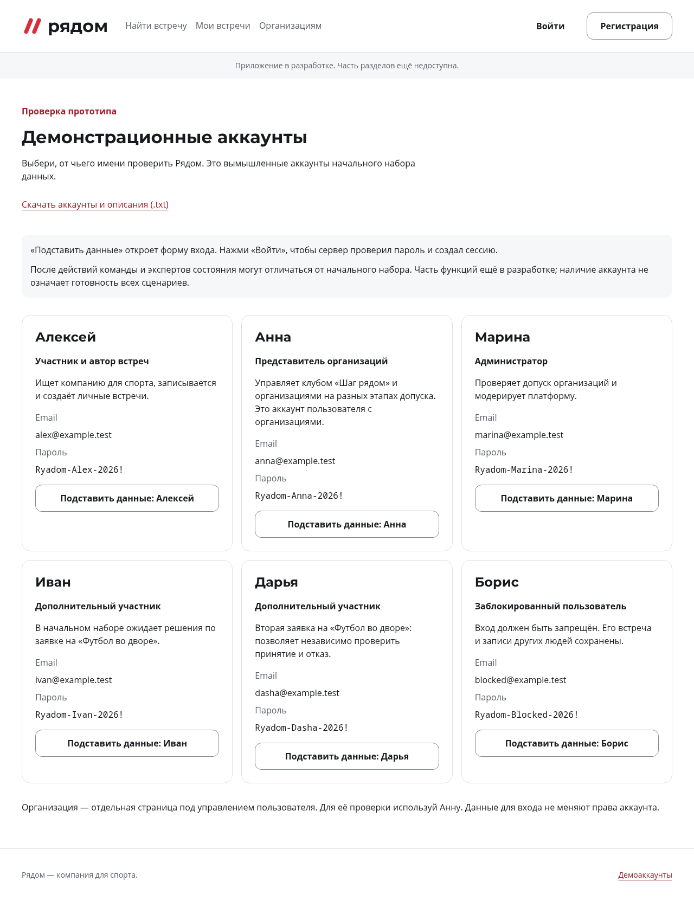
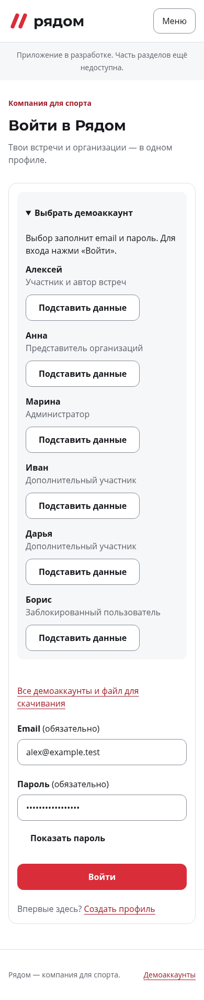

# DEC-24 — демодоступы и уточнения к сдаче

20 октября 2026, локальная реализация по выбору пользователя. Результат включён
в [общую точку продолжения](../../../handoff/continuation-2026-10-20.md) по
последующему поручению о коммите и push. Требования PDF и OpenAPI 0.13.0 сохраняются.

## Результат

- [Страница демодоступов](http://127.0.0.1:4180/demo) и
  [файл UTF-8](http://127.0.0.1:4180/demo/accounts.txt) доступны в общем preview.
- В форме входа есть сворачиваемый выбор. Подставляются email/пароль;
  явная кнопка «Войти» выполняет обычный запрос к серверу. Действующая сессия
  не заменяется выбором другого профиля. Пароли не передаются в URL/storage.
- Единый [список](../../../../../apps/web/demo-accounts.json) содержит шесть
  реальных вымышленных доступов DB-02. Анна управляет организациями, Борис —
  исходно заблокированная цель. Описания не обещают готовность остальных модулей.
- `WEB_DEMO_ACCESS=true` включает публичную помощь в контейнерной сборке.
  По умолчанию выключена; смена требует пересборки web. Это не DEMO_MODE сброса.
- В [условиях сдачи](../../../delivery-brief.md) зафиксированы 23:00 GMT+7,
  ответственность пользователя за финальные коммит/презентацию, защита командой
  8 минут, предоставленная машина/интернет и готовые доступы GitVerse.
  Акцент на спорте и понятности старшей аудитории передан FE/QA.

## Исправление при интеграции

Папка `demo/` с файлом вызывала редирект Nginx с `/demo` на недоступный каталог:
добавлен отдельный маршрут к SPA. Проверено в настоящем веб-образе.

При входе Анны `/me` и login возвращали `DRAFT` для организации без заявки.
Такого значения нет в ApprovalState API 0.13.0, и статус ломал профиль.
В `accounts.Me` добавлено преобразование SQL DRAFT → HTTP NOT_SUBMITTED;
проверка AUTH интеграции теперь проверяет допустимые значения контракта.
SQL, миграции, содержимое БД, DTO и версия контракта не изменены.

## Проверено

| Проверка | Результат |
| --- | --- |
| TypeScript, сборка с выключением и контейнерные сборки с включением/выключением | Успешно |
| Vitest | 99/99; включая соответствие шести имён/email/паролей фактическому Go-сиду |
| Playwright на HTTP-фикстурах | 27/27: 18 существующих auth и 9 demo; явный submit, download, returnTo, блокировка/лимит, сохранение текущего аккаунта, клавиатура, 320/390/768/1280 px |
| Реальный web/API/PostgreSQL | Файл и скачивание; пять успешных входов/выходов, роль ADMIN, отказ Борису, HttpOnly cookie, ровно ожидаемые POST; узкая ширина и 200% |
| Отдельный контейнер с отключением | Файл 404, страница отсутствует, нет выбора/ссылки; обычная форма входа доступна |
| Отключённая Vite-сборка | Нет файла и email/паролей демоаккаунтов в JS-ресурсах |
| Go/PostgreSQL | Полный `go test -race -count=1 ./...` без пропуска SQL-групп; временная отдельная БД |
| Общие материалы | check_repository.py, check_handoff.py, check_api_contract.py и git diff --check |

Снимки реальной контейнерной версии просмотрены, также выполнен визуальный
просмотр во встроенном браузере. Текущий preview сохранён: обновлены web/API,
прежний том, JWT-ключ и существующие сессии сохранены. Общая БД не сбрасывалась,
сценарии встреч не подменялись моками. Тестовые контейнеры удалены отдельно.

## Воспроизведение

После установки зависимостей из корня:

```bash
pnpm typecheck
pnpm build
pnpm exec vitest run apps/web/src --exclude '**/*.spec.ts'
VITE_DEMO_ACCESS=true pnpm exec playwright test --config apps/web/src/app/tests/playwright.config.ts apps/web/src/features/demo/demo.spec.ts apps/web/src/features/auth/tests/auth.spec.ts
```

Для системного Chrome добавить `PLAYWRIGHT_CHROMIUM_EXECUTABLE_PATH=/usr/bin/google-chrome`.
Новые demo-тесты пропускаются, если VITE_DEMO_ACCESS не включён явно.

Контейнерный тест после явного начального seed и включённой сборки:

```bash
OPS_BASE_URL=http://127.0.0.1:4180 node infra/tests/demo_browser.cjs
```

Для отдельной сборки с отключением передать `OPS_DEMO_ACCESS=false` и её адрес.
Этот тест проверяет форму/404, не создаёт и не сбрасывает данные.
Инструкция [включения](../../../../../infra/README.md) описывает Docker-параметр.

Область изменений: `apps/web/demo-accounts.json`, `features/demo/**`, подключения
AuthPage/App/AppShell, Vite/Compose/Nginx, узкая правка accounts и её AUTH-тест,
документы/инструкции передачи. Общих контрактных изменений нет.
Остальные ограничения [промежуточной интеграции](../README.md) сохраняются:
API встреч и последующие бизнес-модули ещё не реализованы; сетевая приёмка
по адресу пользователя впереди. Презентацию агент не создавал.




