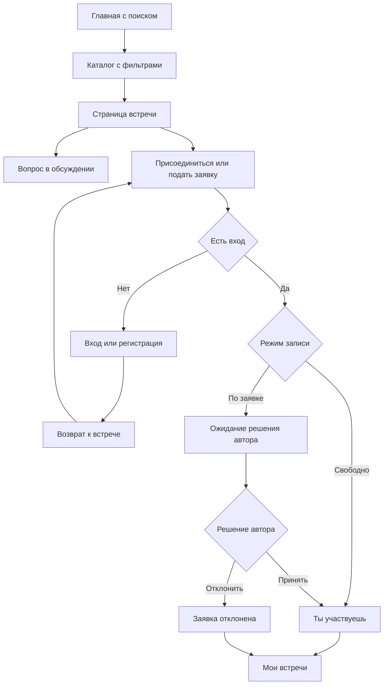

# Предлагаемые пользовательские пути

Статус: **предложение, не реализованный прототип**. Использует
[карту экранов](screens.md), [проект API](../contracts/api-proposal.md),
[права](../architecture/access-and-states.md) и [сценарии приёмки](acceptance.md).
SCR-* — страницы предложения; S1–S6/A1–A6 — декомпозиция требований.

## Поиск и первое участие

Посетитель может открыть встречу напрямую, минуя главную. Вопрос тоже требует
входа перед отправкой, но не требует записи. Возврат после входа сохраняет цель
и требует повторного подтверждения действия; не выполняет запись автоматически.
Если за время входа встречу сняли, показывается актуальная недоступность.

## Создание человеком S1

SCR-01/02/08 → вход при необходимости → SCR-10 → проверка → опубликованная SCR-03.
Создание содержит выбор готового направления или собственного названия. Авторство
личное; после успеха виден переход на SCR-11. Второй пользователь находит встречу
в SCR-02 и открывает ссылку на человека в SCR-04.

Ветки: ошибка поля сохраняет заполнение; ошибка сети не объявляет публикацию
успешной; неизвестный результат ведёт к проверке своих встреч. Переходы между
шагами формы не создают записи в БД. Настоящий черновик пока не предлагается.

## Допуск организации S2

SCR-08 → SCR-12 → SCR-13 → SCR-14 → подача заявки. Представитель видит PENDING.
Администратор: SCR-15 → SCR-16 → одобрение или отказ с причиной.

При одобрении представитель обновляет SCR-14, получает публичную SCR-05 и
создание SCR-10 с выбранной организацией. Публикация сразу доступна другому
пользователю в каталоге и на странице организации, без второй очереди модерации.

При отказе причина видна в SCR-14; публичная страница и публикация от организации
не открываются. Повторная подача не изображается рабочей функцией базовой версии.
До рассмотрения прямой публичный URL не раскрывает частный профиль.

## Свободная запись S3

SCR-02 → SCR-03 OPEN → «Присоединиться» → подтверждённый ответ → «Ты участвуешь».
Запись появляется в SCR-09 «Участвую», у автора — в SCR-11 среди участников.
Второе нажатие/повтор запроса не создаёт вторую запись. Отдельного решения автора нет.

## Запись по заявке S4

SCR-02 → SCR-03 APPROVAL → «Подать заявку» → PENDING. Пользователь видит ожидание
в карточке и SCR-09 «Заявки», автор — строку для решения в SCR-11.

Принятие: CONFIRMED у обеих сторон, запись переходит в подтверждённый состав.
Отказ: REJECTED у обеих сторон, пользователь остаётся вне состава участников.
Проверяются обе ветки на разных заявках. Права администратора сами по себе не
позволяют выполнить решение в SCR-11. Конфликт состояния обновляет данные,
а не перезаписывает уже сделанный выбор.

## Уточнение условий S5

SCR-03 → обсуждение → вход при необходимости → отправка вопроса → сохранённое
сообщение с автором. Организатор открывает ту же встречу, отвечает, пользователь
видит ответ после обновления. Вопрос без записи — обязательная проверка для
открытой встречи. Внешний чат не заменяет этот путь.

Сбой отправки сохраняет текст в текущей форме. Неизвестный результат не вызывает
автоматическую повторную отправку POST. После смены аккаунта набранный текст
предыдущего человека не переносится новому пользователю.

## Снятие с публикации S6

Администратор: SCR-17 → SCR-18 → диалог снятия → обязательная причина → результат.
Каталог и публичная страница организации больше не предлагают встречу для записи.

Автор и человек с записью: SCR-09 либо кабинет организации → SCR-03 с ограниченной
карточкой недоступности. Автору видна причина. Существующие записи сохраняются,
новая запись, вопрос и решения по заявкам запрещены. Сохранённая прямая ссылка
и прямой POST не обходят состояние. Для остальных пользователей SCR-03 даёт 404.

Если участник записался раньше снятия в порядке транзакций, его запись сохраняется
с предупреждением. Если снятие произошло раньше, подтверждённая запись не создаётся.
Проверка не требует физического удаления и не объявляет встречу отменённой.

## Административные действия вне шести строк

Поиск организации/встречи → детали → автор/профиль → связанные события/обсуждение
проверяется как единый путь A2. Непубличный профиль доступен администратору через
его кабинет, а не через публичный маршрут организации.

Скрытие сообщения A3: SCR-18 → нужное сообщение → подтверждение скрытия.
Администратор видит скрытый оригинал, обычный читатель — подпись вместо текста.
Остальные сообщения и событие не исчезают. Не требуется отдельный экран чатов.

## Покрытие приёмки экранами

| Проверка | Основные экраны | Что должно быть видно |
| --- | --- | --- |
| S1 | SCR-02/03/04/10 | Создание, свой вид спорта, просмотр вторым человеком, профиль автора |
| S2 | SCR-05/10/12/13/14/15/16 | До/после допуска, отказ с причиной, публикация |
| S3 | SCR-03/09/11 | Немедленное подтверждение и состав автора |
| S4 | SCR-03/09/11 | Ожидание, принятие и отказ у обеих сторон |
| S5 | SCR-03 | Вопрос и ответ, авторство, доступ до записи |
| S6 | SCR-02/03/09/14/17/18 | Причина, отсутствие в выдаче, недоступность по ссылке |
| A1 | SCR-06/07 | Отдельно показаны вход и регистрация с понятной имитацией |
| A2 | SCR-15/16/17/18 | Поиск, состояния и связанные переходы |
| A3 | SCR-03/18 | Одно скрытое сообщение при сохранении обсуждения |
| A4 | SCR-02/03/10 | Разные виды спорта и своё направление |
| A5 | Все выбранные | Адаптивность, читаемость, клавиатура, состояния |
| A6 | Все изменяющие действия | Реальные данные после чтения из API, без локальной подмены |

## Как проверить предложение до разработки

Подготовить схемы блоков ключевых страниц и пройти пути по вымышленным данным:
новый посетитель, участник, личный автор, представитель до/после допуска,
администратор. Проверять каждый следующий шаг и возможность вернуться назад.

Для одной встречи показать варианты OPEN, APPROVAL/PENDING, CONFIRMED, REJECTED,
UNPUBLISHED и ошибки операции. Для организации — все состояния допуска.
Для каталога — заполненную и пустую выдачу с фильтрами. Эти схемы проверяют
понятность пути; техническая приёмка позже требует работающего приложения.

После этого согласовать состав экранов и ограничения, уточнить контракты и
зафиксировать макеты выбранных страниц. Только затем переходить к реализации.
