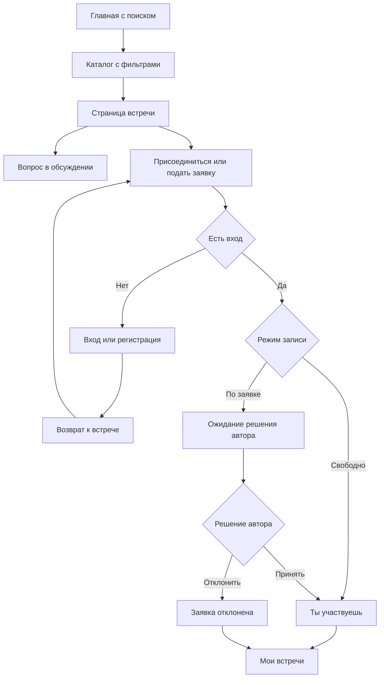

# Предлагаемые пользовательские пути

Статус: **предложение, не реализованный прототип**. Использует
[карту экранов](screens.md), [проект API](../contracts/api-proposal.md),
[права](../architecture/access-and-states.md) и [сценарии приёмки](acceptance.md).
SCR-* — страницы предложения; S1–S6/A1–A6 — декомпозиция требований.

Уточнение пользователя — [DEC-01/02](decisions.md), API 0.13.0: запись и решения
автора разрешены только до startsAt. В момент начала и позже API возвращает
EVENT_STARTED, включая повтор; клиент перечитывает состояние и поясняет закрытие.
Автор продолжает читать состав, PENDING сохраняется, обсуждение опубликованной
встречи доступно по прежним правам. Во всех путях время начала — в зоне встречи
с явной подписью. Описанные ниже успешные пути записи/решений проходят до начала.

## Поиск и первое участие

Новый пользователь на SCR-07 вводит имя, email/пароль и обязательно выбирает готовый аватар.
«Создать профиль» сохраняет аккаунт, аватар и сессию одним действием; пустой каталог блокирует регистрацию,
пропуск не разрешён. После подтверждённого ответа — исходный returnTo либо персональная главная SCR-01 (DEC-16).
В личном кабинете позднее доступны замена готовой и загрузка своего SVG с проверкой.
Полные состояния/ошибки/повторный вход — [регистрация DEC-11](registration.md).

Посетитель может открыть встречу напрямую, минуя главную. Вопрос тоже требует
входа перед отправкой, но не требует записи. Возврат после входа сохраняет цель
и требует повторного подтверждения действия; не выполняет запись автоматически.
Если за время входа встречу сняли, показывается актуальная недоступность.

## Создание человеком S1

SCR-01/02/08 → вход при необходимости → SCR-10 → проверка → опубликованная SCR-03.
Создание содержит выбор готового направления или собственного названия. Авторство
личное; после успеха виден переход на SCR-11. Второй пользователь находит встречу
в SCR-02 и открывает ссылку на человека в SCR-04.

Ветки: ошибка поля сохраняет заполнение; ошибка сети не объявляет публикацию
успешной; неизвестный результат ведёт к проверке своих встреч. Переходы между
шагами формы не создают записи в БД. Настоящий черновик пока не предлагается.

## Допуск организации S2

SCR-08 → SCR-12 → SCR-13 → SCR-14 → подача заявки. Представитель видит PENDING.
Администратор: SCR-15 → SCR-16 → одобрение или отказ с причиной.

При одобрении представитель обновляет SCR-14, получает публичную SCR-05 и
создание SCR-10 с выбранной организацией. Публикация сразу доступна другому
пользователю в каталоге и на странице организации, без второй очереди модерации.

При отказе причина видна в SCR-14; публичная страница и публикация от организации
не открываются. Повторная подача не изображается рабочей функцией базовой версии.
До рассмотрения прямой публичный URL не раскрывает частный профиль.

## Свободная запись S3

SCR-02 → SCR-03 OPEN → «Присоединиться» → подтверждённый ответ → «Ты участвуешь».
Запись появляется в SCR-09 «Участвую», у автора — в SCR-11 среди участников.
Второе нажатие/повтор запроса не создаёт вторую запись. Отдельного решения автора нет.

## Запись по заявке S4

SCR-02 → SCR-03 APPROVAL → «Подать заявку» → PENDING. Пользователь видит ожидание
в карточке и SCR-09 «Заявки», автор — строку для решения в SCR-11.

Принятие: CONFIRMED у обеих сторон, запись переходит в подтверждённый состав.
Отказ: REJECTED у обеих сторон, пользователь остаётся вне состава участников.
Проверяются обе ветки на разных заявках. Права администратора сами по себе не
позволяют выполнить решение в SCR-11. Конфликт состояния обновляет данные,
а не перезаписывает уже сделанный выбор.

## Уточнение условий S5

SCR-03 → обсуждение → вход при необходимости → отправка вопроса → сохранённое
сообщение с автором. Организатор открывает ту же встречу, отвечает, пользователь
видит ответ после обновления. Вопрос без записи — обязательная проверка для
открытой встречи. Внешний чат не заменяет этот путь.

Сбой отправки сохраняет текст в текущей форме. Неизвестный результат не вызывает
автоматическую повторную отправку POST. После смены аккаунта набранный текст
предыдущего человека не переносится новому пользователю.

## Снятие с публикации S6

Администратор: SCR-17 → SCR-18 → диалог снятия → обязательная причина → результат.
Каталог и публичная страница организации больше не предлагают встречу для записи.

Автор и человек с записью: SCR-09 либо кабинет организации → SCR-03 с ограниченной
карточкой недоступности. Автору видна причина. Существующие записи сохраняются,
новая запись, вопрос и решения по заявкам запрещены. Сохранённая прямая ссылка
и прямой POST не обходят состояние. Для остальных пользователей SCR-03 даёт 404.

Если участник записался раньше снятия в порядке транзакций, его запись сохраняется
с предупреждением. Если снятие произошло раньше, подтверждённая запись не создаётся.
Проверка не требует физического удаления и не объявляет встречу отменённой.

## Административные действия вне шести строк

Поиск организации/встречи → детали → автор/профиль → связанные события/обсуждение
проверяется как единый путь A2. Непубличный профиль доступен администратору через
его кабинет, а не через публичный маршрут организации.

Скрытие сообщения A3: SCR-18 → нужное сообщение → подтверждение скрытия.
Администратор видит скрытый оригинал, обычный читатель — подпись вместо текста.
DEC-08: в SCR-03 вошедший жалуется на встречу/чужое видимое сообщение без причины
и без обязательной записи. Повтор возвращает ту же квитанцию. В SCR-17 фильтр
«Есть жалобы» ведёт в SCR-18: снять встречу с причиной, скрыть одно сообщение
или отклонить жалобы без изменения контента. Снятие закрывает прямые жалобы,
скрытие — только жалобы сообщения. ADMIN может восстановить HIDDEN на прежнее
место без причины; публикация не меняется. При конфликте формы перечитывается
актуальное состояние. Полные правила — [жалобы и модерация](reports-and-moderation.md).
Остальные сообщения и событие не исчезают. Не требуется отдельный экран чатов.

## Покрытие приёмки экранами

| Проверка | Основные экраны | Что должно быть видно |
| --- | --- | --- |
| S1 | SCR-02/03/04/10 | Создание, свой вид спорта, просмотр вторым человеком, профиль автора |
| S2 | SCR-05/10/12/13/14/15/16 | До/после допуска, отказ с причиной, публикация |
| S3 | SCR-03/09/11 | Немедленное подтверждение и состав автора |
| S4 | SCR-03/09/11 | Ожидание, принятие и отказ у обеих сторон |
| S5 | SCR-03 | Вопрос и ответ, авторство, доступ до записи |
| S6 | SCR-02/03/09/14/17/18 | Причина, отсутствие в выдаче, недоступность по ссылке |
| A1 | SCR-06/07 | Отдельно показаны вход и регистрация с понятной имитацией |
| A2 | SCR-15/16/17/18 | Поиск, состояния и связанные переходы |
| A3 | SCR-03/18 | Одно скрытое сообщение при сохранении обсуждения |
| A4 | SCR-02/03/10 | Разные виды спорта и своё направление |
| A5 | Все выбранные | Адаптивность, читаемость, клавиатура, состояния |
| A6 | Все изменяющие действия | Реальные данные после чтения из API, без локальной подмены |

## Проверка и включение нового направления — DEC-07

SCR-10 → свой вид спорта → createEvent создаёт PENDING и опубликованную встречу
одной транзакцией → SCR-03 доступна другим, запись работает без ожидания проверки.
Имя отсутствует в общем списке, но встреча находится по тексту и activityTypeId.
ADMIN открывает SCR-20 → одобряет, исправляет и одобряет либо не включает с причиной.
Автор опубликованной встречи видит результат через activityTypeReview после чтения.
Отказ сохраняет возможность использовать имя, повтор не создаёт новую проверку.
Слияние отложено; коллизия исправления даёт конфликт без изменения данных.
Полные правила — [в спецификации направлений](activity-types.md).

## Как проверить предложение до разработки

Подготовить схемы блоков ключевых страниц и пройти пути по вымышленным данным:
новый посетитель, участник, личный автор, представитель до/после допуска,
администратор. Проверять каждый следующий шаг и возможность вернуться назад.

Для одной встречи показать варианты OPEN, APPROVAL/PENDING, CONFIRMED, REJECTED,
UNPUBLISHED и ошибки операции. Для организации — все состояния допуска.
Для каталога — заполненную и пустую выдачу с фильтрами. Эти схемы проверяют
понятность пути; техническая приёмка позже требует работающего приложения.

После этого согласовать состав экранов и ограничения, уточнить контракты и
зафиксировать макеты выбранных страниц. Только затем переходить к реализации.

## Готовый и личный SVG-аватар — DEC-09/10

SCR-08: открыть готовые варианты → выбрать → подтверждённый ответ сервера →
готовая аватарка видна второму пользователю без новой проверки. Повтор выбора
безопасен. Пока файлов нет, список пуст с предложением загрузить свой SVG.
Готовый выбор заменяет личный; личная загрузка после PRESET требует одобрения.
Сброс очищает оба вида выбора; исключённый ID даёт заглушку и предложение замены.

SCR-08: выбрать файл SVG → загрузить → «На проверке», приватный предпросмотр.
Другой пользователь в SCR-04/обсуждении видит заглушку. SCR-21: ADMIN открывает
текущую версию → одобряет → после чтения публично виден SVG. ADMIN может скрыть
его без причины, а затем восстановить одобрением. Новая загрузка опять PENDING,
сброс возвращает EMPTY с сохранением версии. Старая форма/URL не относятся к новому
файлу; конфликт перечитывает данные, без автоматической отправки решения заново.
Правила и ограничения — [аватары](avatars.md); макет 0.2 этот путь не реализует.

## Сброс перед новой демонстрацией — DEC-13

ADMIN → SCR-08 → «Восстановить демоданные» → версия/дата/последствия → ввод
СБРОСИТЬ → один подтверждённый запрос → штатный сид → очистка кеша/форм →
вход заново. Все сессии закрыты, предметные UUID новые. Ошибка с откатом не
показывает успех; потерянный ответ проверяется по resetId после входа ADMIN по email/паролю.
Полные правила/конкуренция/границы — [сброс демобазы](demo-reset.md).

## Личные планы и переход после входа — DEC-14–16

Без returnTo подтверждённый вход/регистрация ведут в SCR-01: три ближайших
CONFIRMED/PUBLISHED, ниже отдельно начавшиеся сегодня. С безопасной целью —
прямо к ней, без автоматической записи/вопроса. «Мои встречи» ведёт в SCR-09,
«Участвую»: предстоящие по началу ASC, «Начавшиеся» — все начатые DESC,
«Все записи» — также ограниченные снятые публикации. Фильтр сбрасывает курсор,
не меняет статус участия и не подтверждает посещение. Детали — [DEC-15/16](decisions.md).

## Чтение обсуждения и выбор календарной даты — DEC-18/19

SCR-03 → последние сообщения → «Более ранние» сверху. После подтверждённого
вопроса/ответа читается свежий хвост, не первая страница старейших; при timeout
совпадение текста не доказывает отправку и POST автоматически не повторяется.
HIDDEN остаётся на своём месте без body на публичном маршруте.

SCR-02 → явная дата/диапазон → события в этих календарных днях по зоне каждой
встречи. Для «7–9 ноября» dateFrom=7/dateTo=10; from/to при наличии отдельно
ограничивают абсолютный момент. Смена фильтра сбрасывает курсор. Это не сдвиг
границ по зоне устройства. Макет пока не отражает эти уточнения.

## Вход и блокировка — DEC-20/21

SCR-06 → email/пароль → login → безопасный returnTo либо SCR-01. После выхода
зарегистрированный человек возвращается тем же способом, без выбора demoKey.
ADMIN → SCR-22 → поиск/панель USER → подтверждение → status/expectedRevision.
У пользователя завершаются все сессии, UI очищает личный кеш и показывает блокировку.
Контент/участие/допуск сохраняются; остальные видят недоступность организатора.
Разблокировка → новый login, прежние JWT не работают. Ошибка/конфликт не показываются
как успех, состояние перечитывается. См. [вход](../architecture/authentication.md)
и [блокировку](account-blocking.md).
